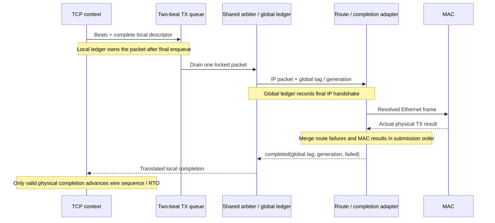

# Integrating the current endpoint

This describes `MultiEthernetTcpUdpEndpoint` and its compatible single-session
`EthernetTcpUdpEndpoint`. A MAC
adapter, DMA engine, CSR block and Linux driver are **not included** yet.
The source remains authoritative for bundle fields and elaboration parameters.

## Clock, configuration and streams

The protocol core uses one clock. Its target is 156.25 MHz, with 16 bytes per
beat. Generate `tick` as a one-clock pulse at `ticksPerSecond` (default 1000):
at the target clock, one pulse every 156,250 clocks. Timer tick rate is a
configuration contract, not an Ethernet clock recovered from a peer.
Use explicit packet FIFOs/CDC for independent MAC or system clock domains;
the existing timing fixture verifies none of those crossings.

Configure local MAC/IP, netmask, gateway and MTU while quiescent. Configure
TCP MSS to fit the path MTU; there is no ICMP PMTU discovery. Set an appropriate
`congestionWindow` upper cap even when autonomous Reno is enabled; zero
prevents new data transmission. Provide an ISN policy through open fields and
`passiveInitialSequence`; there is no autonomous secure ISN generator.

In `PacketBeat(16)`, the first byte occupies bits 7:0, `keep` is a contiguous
low-bit prefix, and every nonfinal beat is full. A producer holds all offered
values stable under backpressure. MAC streams start at the destination MAC
address and omit preamble/SFD, FCS and IFG.

On ingress the physical wire cannot pause for `rx.ready`. The adapter must
buffer or drop complete frames and propagate receive errors. The core checks
whole packets before committing payload; the adapter must not lose a tail and
silently convert a damaged frame into a valid shorter frame. On egress the
adapter must prevent wire underrun, provide minimum framing/FCS/IFG handling
as appropriate, and preserve TCP metadata per frame. The core already pads
Ethernet frames to the minimum pre-FCS length.

## TCP application interface

The multi endpoint exposes `connections(i)` for each connection. Its fields
`open`, `close`, `notice`, `allocate`, `in`, `stored` and `received` correspond to
the single endpoint's TCP interface. Each context has independent state,
generation, window, storage, timer and Reno/SACK recovery. Configure several
passive slots with the same local port to accept several peers concurrently.
A listener slot becomes that accepted connection; open another free slot to
maintain listener capacity. Active duplicate tuples are backpressured and
reported by `openConflict`; withdraw or change the conflicting request.

1. Submit active or passive `open` only through its ready/valid handshake.
   Read `notice` and state; each passive slot accepts one session at a time.
2. For each write, handshake `tcpAllocate` with length/context, transfer the
   corresponding packed bytes through `tcpIn`, then consume `tcpStored`.
   Production writes fit one 2 KiB bank. Split a larger stream into writes.
3. A successful store result means local ownership transfer, not peer delivery.
   Retained banks remain owned until cumulative ACK; replay is internal.
4. Consume `tcpOut` as a byte stream. `last` marks an output chunk, not a peer
   packet or EOF. Application backpressure reduces advertised RX credit.
5. Submit `close.bits=false` for graceful close; `true` aborts. Graceful close
   waits for scheduled/actually transmitted data before sending FIN.
   Drain unread bytes after peer FIN/normal close. Reset/abort cancel them.

Notices use flags: bit 0 established, bit 1 peer FIN, bit 2 closed,
bit 3 reset, bit 4 abort; flags can be combined. Reopening waits for old RX
bytes and TX ownership to drain. Keep consuming notices/store results;
indefinite control backpressure can stop protocol progress.

A passive connection returning from SYN-RECEIVED to LISTEN retains its tuple
until old SYN-ACK frames and physical completions drain. Packets still finishing
validation, including corrupt packets behind the RST, cannot release that tuple
early. Another slot may use it only after this ownership barrier has cleared.

Read-to-empty window updates are coalesced for up to 32 clocks after the final
application read. Batched credit (at most 1460 bytes or half the ring capacity)
and a read from a completely full ring trigger immediate update requests.
This avoids an extra window ACK for every byte-sized incoming segment while
ensuring the final partial read is eventually advertised. These are request
latencies; control backpressure can delay actual transmission.

TCP receive reassembly uses eight separate 2 KiB banks in addition to the
application ring. A future segment is eligible only after normal tuple,
sequence, ACK, checksum and connection-state validation. Until its missing
prefix arrives, cumulative ACK stays at the gap. On promotion, only the RX
sequence/FIN state is replayed; its original ACK/window is never processed
twice. Cached FIN is applied only when contiguous.

The cache admits nonoverlapping ranges within the receive window. A full
cache, overlapping cached range, or oversized range is dropped without
blocking the missing prefix. The sender recovers those bytes by retransmission;
SACK is negotiated in the SYN exchange. Only fully written, live-generation
cache payload contributes SACK blocks; FIN sequence space is excluded. Adjacent
ranges merge, and the most recently received retained range is reported first.
At most four blocks fit the generated option area. Snapshot publication can
follow the first gap ACK and generates a subsequent ACK update. Later in-order
traffic may cover a cached prefix,
which is trimmed on replay, or make a whole cached entry obsolete. Reassembly
uses separate memory and does not subtract cached bytes from the application
ring's advertised credit a second time. Ring capacity is reserved when bytes
become contiguous. Reset/abort invalidate the connection generation and drain
active internal copies before reclaiming storage. The extra cache adds no
protocol-level receive capacity beyond the advertised ring window.

The wire-metadata guard observes writer/snapshot work while the receive queue
is idle. RBO admission and duplicate-touch work require the decision state,
so those current-cycle terms are excluded from this guard. The full RBO busy
output still reports them for other low-level consumers. This removes a
redundant admission-to-metadata-ready path without adding a clock or changing
any transfer.

Sender SACK information is advisory: it can skip covered bytes and cap a replay
at the next SACK boundary, but never frees a payload bank or advances SND.UNA.
RTO clears the scoreboard and permits cumulative-ACK-based retransmission,
including recovery if the peer reneges. This bounded ACK-clocked recovery does
not implement all RFC 6675 Pipe/IsLost/rescue behavior. An immutable header
snapshot keeps option length, MSS budgeting and checksum generation consistent
while a packet is waiting for output.
Active OPEN captures the configuration before emitting its SYN on the next
clock. Low-level controlPending includes that pending SYN, so close/abort and
reuse cannot bypass ownership before control.valid is asserted. Inputs may
change immediately after the OPEN handshake.

SACK control-option encoding can add one internal clock for a nonempty
snapshot. Low-level controlPending covers that stage before control.valid,
and remains part of TX ownership. The data-option cache checks ACK base,
generation and block count, omitting an incompatible option while it refreshes;
ACK/window fields remain current and are frozen with the chosen payload budget.

OPEN priority uses registered core availability and a registered grant for
the preceding cycle's unchanged request. A newly reusable context/request can
therefore require qualification clocks before its OPEN handshake. Every
accepted OPEN inserts one grant-qualification bubble while claims refresh.
Current readiness and ingress classification still gate actual handshakes;
request changes and new listener claims cannot use stale eligibility. These
registers cannot bypass old packet/completion ownership. Reassembly scheduling likewise samples receive
credit at the serialized receive boundary. The TCB retains current receive
credit and remains responsible for the exact byte reservation.

Retained-store reads capture request coordinates and ownership before range
validation on the following clock. A valid bank is pinned during validation
if its owner releases it; invalid ranges never pin a release or issue RAM
payload. A release simultaneous with request acceptance still rejects that
read. This adds one request-to-response clock and preserves output ordering
and byte-range semantics.

Data-option payload budgets for absent/one/two/three/four SACK blocks are
computed in parallel and selected with the corresponding option length.
This preserves the exact header/budget handshake while keeping option-length
selection out of the subtraction/clipping path.

Each TCP context has a two-beat TX elastic queue before the shared packet
arbiter. Every buffered beat carries its complete wire descriptor; source
local tags may advance before shared output drains. Aborts preserve buffered
frames and physical-completion ownership. The queue's registered occupancy
cuts cross-context ready propagation while preserving one beat per clock.

fault is a diagnostic event rather than a flow-control input. RX diagnostic
aggregation is registered, and each context registers the final fault OR
before the shared aggregate. These stages add two clocks to RX diagnostics and one clock to connection
diagnostics; individual child detectors can have their own latency. Pulse
events are preserved. Retained-TX release/read diagnostics have one additional
child register before serializer/connection aggregation; packet validation,
abort policy and completion handshakes retain their own direct logic.

In the multi-context top, accepted successful sequence completions reach the
TCB one clock later. Local/global callback acceptance remains immediate; the
pending stage retains context ownership. A sequence-completion cycle also
holds receive-event delivery so an arriving ACK cannot run ahead of the
wire-sequence update. ACK-only completions add no such receive barrier.
Standalone endpoint defaults retain direct completion delivery.

The multi-context dispatcher drains admission and validation before OPEN;
that contract permits the context's receive clear on the following clock.
A newly admitted packet cannot reach receive metadata during that clear.
Standalone endpoints retain immediate OPEN clear.

The TCP transmitter captures header derivatives with the command and computes
a registered checksum seed before admitting the first payload beat. This adds
one cold-start clock while retaining one payload beat per clock and immutable
header/option metadata for the complete packet.
Only the first optionLength option bytes are defined. Unused option-register
bytes may retain older values; checksum and wire-header masking exclude them.

The shared dispatcher validates the tuple prefix before selecting a context;
the selected core still validates the complete packet before state changes.
Unknown tuples and busy contexts drop complete packets. `rxBusyDropped` and
`rxDrops` expose drop events; an external MAC adapter still needs its own
buffer/drop policy. Backpressure on one application's stream must not be
interpreted as permission to stall the physical wire.

The UDP interface accepts a `udpSend` command followed by `udpIn` payload;
`udpOut` carries received datagrams with stable associated address/port/length
metadata. Empty UDP payloads use a single empty final beat.

## Physical completion adapter

Each TCP context has a 16-entry completion ledger by default. The multi core
adds a shared ledger of `connectionCount * completionDepth` entries (64 by
default), translating each global tag to the owner's local tag/generation. Every TCP
packet needs one result, including pure ACKs and persist probes.

At the MAC-facing stream, latch `txTcp`, `txTag` and `txGeneration` for
each accepted TCP frame. `txConnection` identifies its application context;
the completion contract still uses the global tag and generation. Sideband values are meaningful with that frame's
valid stream. Preserve them until the actual physical TX outcome is known.

`routed` is a one-cycle Valid event describing either a TCP frame handed to
the MAC stream or a route drop. It is **not** wire completion. For a route
drop, create a failed completion even though no MAC frame exists. For a
successful route, wait for actual physical transmission; a later MAC error
must produce a failed completion.

Merge route failures and physical outcomes in TCP submission order. A later
route failure must wait behind an earlier buffered MAC frame. Return exactly
one `completed` event with echoed tag/generation and failed status; this is a
Valid interface, so the adapter must serialize outcomes to at most one per
clock. The core rejects stale, duplicate or out-of-order callbacks without
freeing ownership.

The adapter/MAC lanes below describe external integration obligations. The
physical MAC and ordered completion merger are outside this protocol core.

Do not wire `routed` directly to `completed` through a buffered MAC.
Do not infer success merely from a DMA descriptor being queued. Both would
start TCP timers before transmission and could claim unsent sequence bytes.
Completion is legal starting the cycle after the final IP submission handshake.

On abort, an already offered stalled frame still drains and requires its
result. Reset the adapter's frame/completion queues together with the core.
Do not drop old queues while allowing their callbacks to survive reset.

## Hardware application and Linux ownership

A hardware application can use the streams above directly, adding its own
request/response logic and storage. For example, an application protocol
parser consumes TCP bytes after establishment and produces response writes.

A future Linux integration can expose these per-connection operations
through a dedicated driver/API: configure, listen/connect, write, read,
close/abort and events. A proposed implementation would add CSRs plus DMA
submission/completion rings and interrupts. Those register layouts and the
driver ABI have not been implemented or frozen.

That interface currently provides no Linux socket adapter. Supporting normal
socket applications requires additional socket/networking integration and
lifetime/error/readiness semantics. A conventional Ethernet packet interface
is a separate integration choice and would leave TCP processing in software.

Define packet ownership before sharing a link: the current endpoint handles
its configured IPv4 address and dispatches TCP directly into its hardware
connection contexts.
There is no implemented Linux fallback/flow-steering path. Avoid configuring
two independent stacks to own that same local address accidentally.

## Bring-up evidence still needed

After adding the adapter, verify both directions with a real peer, including
ARP cold start/failure, UDP and ping, TCP active/passive open, large and short
writes, loss, partial ACK, zero windows, abort during a stalled frame and
buffer reuse. Correlate physical TX timestamps with completion callbacks.
Then measure sustained useful throughput, packet loss and RTT under defined
traffic and buffer sizes. Simulation service capacity is not that board result.
